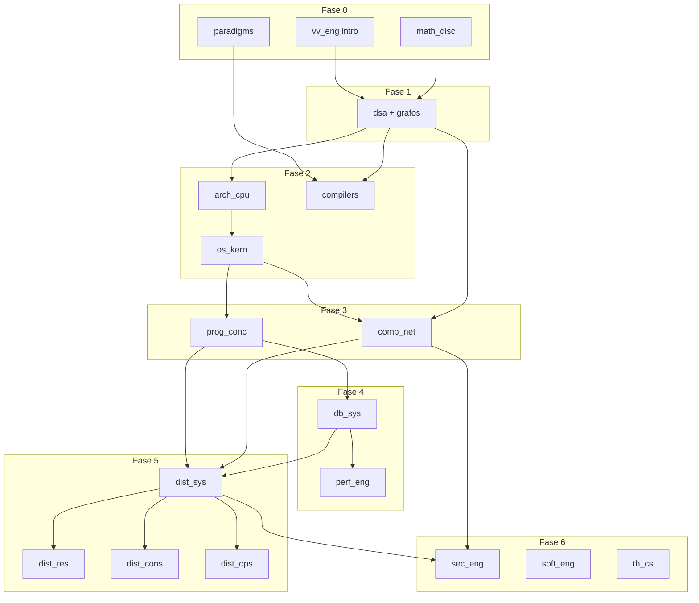

# Catálogo de livros — cs-notebooks

Cada **livro** = pasta na raiz do repositório (`prog_conc/`, `comp_net/`, …). Todos seguem o [molde pedagógico](README.md#molde-pedagógico-todos-os-livros-e-capítulos).

**Progresso e coordenação entre agentes:** [WORKBOARD.md](WORKBOARD.md) (publicados vs roteiro, reivindicações, próxima onda) · [AGENTS.md](AGENTS.md).

## Convenções

| Item | Regra |
| --- | --- |
| **Fase** | Todo livro pertence a uma fase canônica (0–6), indicada no README, catálogo e sumário. |
| **Pré-requisitos** | Cada tópico novo declara o que o estudante precisa já entender; não assume conhecimento implícito de outro tópico/livro. |
| **Pasta** | `snake_case` curto: `comp_net`, `dist_sys`, `db_sys` |
| **Capítulo** | `capitulos/NN-slug/` (`NN` = 01, 02…) |
| **localStorage** | `playground_<pasta>__<chapter-id>` (ver `practice.js` do livro) |
| **Roteiro** | `README.md` do livro + `capitulos/MAPEAMENTO.md` |
| **Sumário** | `node capitulos/_tools/build-index.mjs` |
| **Testes** | `node --test` em `model.test.js` e, se houver, `lib/*.test.js` |
| **Capítulo ouro** | Primeiro capítulo publicado define tom, HTML e lab — depois ondas |

### Criar um livro novo

```sh
node _tools/new-livro.mjs --slug db_sys --title "Bancos de dados" --brand "bancos de dados"
```

Isso copia o esqueleto de `_template-livro/`, traz `styles.css` de `prog_conc/`, e gera `README.md` inicial. Em seguida: escrever roteiro no README, preencher `MAPEAMENTO.md`, implementar cap. **01**, rodar checklist do molde.

## Ordem canônica de estudo

Visão operacional (também em [README.md § Ordem sugerida](README.md#ordem-sugerida-entre-livros-com-dependências)). **Fase** = bloco de working memory; dentro da fase, ordem numérica é recomendada.

### Tabela de dependências

| Livro | Pré-requisitos **recomendados** | Habilita / reforça | Paralelo razoável com |
| --- | --- | --- | --- |
| `vv_eng` (intro) | — | todos os labs e checklists | qualquer |
| `math_disc` | — | `dsa`, `th_cs` | `paradigms` |
| `paradigms` | — | `compilers`, `soft_eng` | `math_disc`, `dsa` |
| **`dsa`** | `math_disc` | `arch_cpu`, `compilers`, `comp_net`, `db_sys`, `dist_*`, `th_cs` | `paradigms` após estruturas básicas |
| `arch_cpu` | `dsa` | `os_kern`, `perf_eng` | `compilers` |
| `compilers` | `dsa`, `paradigms` | leitura de runtime, erros | `arch_cpu` |
| `os_kern` | `arch_cpu` | **`prog_conc`**, `comp_net`, diagnóstico | — |
| **`prog_conc`** | `os_kern` (processos/threads) | `db_sys` (isolamento), `dist_sys` | **`comp_net`** |
| **`comp_net`** | `dsa` (grafos em rotas), `os_kern` leve | `dist_sys`, `sec_eng`, `dist_ops` | **`prog_conc`** |
| `db_sys` | `prog_conc`, `dsa` | `dist_sys`, `perf_eng` | — |
| `perf_eng` | `dsa`, `arch_cpu`, `comp_net`, `db_sys` parcial | `dist_ops`, SLOs | — |
| `dist_sys` | `comp_net`, `prog_conc`, `db_sys` | `dist_res`, `dist_cons`, `dist_ops` | — |
| `dist_res` | `dist_sys` | produção resiliente | `dist_cons` após núcleo |
| `dist_cons` | `dist_sys`, `prog_conc` | consistência forte | `dist_res` |
| `dist_ops` | `dist_sys`, `comp_net`, `perf_eng` | microservices, observability | `dist_res` |
| `sec_eng` | `comp_net`, `dist_*`, `db_sys` | — | — |
| `soft_eng` | `paradigms`, `vv_eng` | — | qualquer (transversal) |
| `th_cs` | `math_disc`, `dsa` | — | `soft_eng` |

### Sequência por fases (números)

1. **Fase 0:** `vv_eng` (intro) → `math_disc` → (`paradigms` cedo ou adiado)  
2. **Fase 1:** **`dsa`** (inclui bloco completo de grafos — [escopo](#escopo-dsa-inclui-teoria-dos-grafos))  
3. **Fase 2:** `arch_cpu` → `compilers` (ordem flexível entre 2a/2b) → `os_kern`  
4. **Fase 3:** **`prog_conc`** ∥ **`comp_net`** (após base de SO; ver tabela)  
5. **Fase 4:** `db_sys` → `perf_eng`  
6. **Fase 5:** `dist_sys` → `dist_res` + `dist_cons` + `dist_ops` (ou um livro só no início)  
7. **Fase 6:** `sec_eng`, `soft_eng` (contínuo), `th_cs`

**Estado do repositório:** fases 3–4 parcialmente cobertas por **`prog_conc`** (publicado) e **`comp_net`** (em progresso). Se algo “não encaixa”, consulte a fase acima em vez de pular capítulos dentro do livro.



### Escopo `dsa` (inclui teoria dos grafos)

O livro **`dsa`** concentra **tudo de relevante em grafos para CS/SE aplicado** (não repartir em outro livro). `math_disc` traz definições (vértice, aresta, caminho, ciclo, conectividade) e provas leves; **`dsa`** traz representação e algoritmos.

| Bloco | Conteúdo previsto (caps. ou sub-roteiro) |
| --- | --- |
| Fundamentos | complexidade, vetor, lista, pilha/fila, hash, heap |
| Árvores | BST, balanceamento intro, heap como fila de prioridade |
| Ordenação / busca | comparativos, estabilidade, limite informacional básico |
| **Grafos — representação** | lista de adjacência vs matriz; peso; dirigido/não dirigido |
| **Grafos — travessia** | BFS/DFS; tempos de descoberta; componentes |
| **Grafos — estrutura** | bipartição; DAG; detecção de ciclo |
| **Grafos — caminhos** | caminho mínimo: Dijkstra, Bellman-Ford; caminho em DAG |
| **Grafos — árvores** | MST (Kruskal, Prim); árvore geradora mínima vs shortest path |
| **Grafos — ordem** | ordenação topológica; aplicações (deps, build) |
| **Grafos — avançado intro** | fluxo máximo / corte mínimo (visão operacional); matching intro opcional |
| **Grafos — conexões** | pontes com `comp_net` (rotas como caminhos), `dist_sys` (réplica como grafo), `th_cs` (NP em grafos em `th_cs`, não re-didatar em `dsa`) |

Cada tópico = experimento pequeno (prever complexidade ou resultado de BFS/Dijkstra em grafo fixo), alinhado ao molde pedagógico.

### Seção final de `dsa`: coding patterns para interview prep

Parte aprovada do escopo curricular da Fase 1. Vem após o núcleo de estruturas, complexidade e grafos; retoma os fundamentos por reconhecimento de problemas e transferência. Cada padrão pode ocupar mais de um capítulo, mantendo um fenômeno por capítulo.

| Padrão | Aplicações e condições a explorar |
| --- | --- |
| Hash map e conjunto | Frequências, duplicatas e complementos; custo esperado e colisões |
| Dois ponteiros | Pares em sequência ordenada, comparação pelas extremidades e partição |
| Janela deslizante | Janelas fixas e variáveis; condições de monotonicidade; contraexemplo com negativos |
| Somas prefixadas | Consultas de intervalo e contagem de subarrays combinada com hash |
| Ordenação e intervalos | Mesclagem, sobreposição e eventos; convenção de extremos |
| Busca binária na resposta | Predicado de viabilidade monotônico, limites e primeira/última resposta válida |
| Ponteiros rápido e lento | Ciclos e ponto médio em listas |
| Reversão de lista encadeada | Invariante das ligações; reversão completa e de segmentos |
| Pilha e fila monotônicas | Próximo maior, temperaturas e máximo em janela; análise amortizada |
| Top K e dois heaps | Seleção de extremos e mediana de fluxo |
| Travessias de árvores | DFS/BFS, estado no caminho e combinação de resultados das subárvores |
| Backtracking | Subconjuntos, combinações e permutações; restauração de estado e poda |
| Padrões de grafos | Grades, BFS multiorigem, dependências e Union-Find; reaproveitar algoritmos do núcleo |
| Greedy | Seleção local com argumento de correção e contraexemplos para heurísticas |
| Programação dinâmica | Estado/transição/base; memoização e tabulação; sequência linear, mochila/subconjuntos e duas sequências |
| Trie | Prefixos e compartilhamento de buscas por palavras |
| Manipulação de bits | Flags, máscaras de conjuntos pequenos e XOR; limites dos operadores JavaScript |

Formato de cada unidade: sinais de reconhecimento e pré-condições → solução direta → invariante e otimização → implementação e custos de tempo/espaço → problema resolvido → variações → contraexemplo de uso indevido → transferência sem revelar o padrão. Labs com entradas manipuláveis e rastros de execução, exercícios e gabaritos completos seguem o molde geral.

Fechamento: problemas mistos sem rótulo e condução de uma resolução de entrevista (esclarecer restrições, apresentar abordagem, implementar e verificar casos extremos). Programação dinâmica e padrões de grafos devem ser divididos em unidades menores. A divisão e os slugs serão definidos no MAPEAMENTO do livro antes da autoria.

### Fase 1 curricular: proposta de execução

1. **Preparar o livro:** criar `dsa` com o gerador; definir README, pré-requisitos, roteiro completo em MAPEAMENTO e metadados. Separar núcleo e seção final de padrões, explicitando dependências entre capítulos.
2. **Onda inicial:** contagem de operações, crescimento assintótico, vetores, busca linear e busca binária. Medir operações em entradas controladas, sem usar tempo de relógio como prova de complexidade.
3. **Estruturas e ordenação:** listas, pilhas/filas, hash, recursão, ordenação, árvores, heaps e Union-Find. Incluir invariantes, custos amortizados quando pertinentes e casos adversos.
4. **Grafos:** representações → BFS/DFS → componentes/ciclos/bipartição → DAG/topológica → caminhos mínimos → MST → fluxo/corte introdutórios. Comparar pré-condições e objetivos dos algoritmos.
5. **Coding patterns:** seguir a seção final acima, garantindo fundamentos de greedy, backtracking e programação dinâmica antes dos problemas de transferência e da prática mista.
6. **Fechar a fase:** conferir cobertura do roteiro e pré-requisitos, links, gabaritos e catálogo; testes Node dos modelos, validação estática, manutenção e atualização do WORKBOARD. Testes reais de navegador ficam fora do escopo por preferência do usuário.

Estrutura de `dsa` criada em 2026-11-26: [README](dsa/README.md) e [roteiro canônico de 59 capítulos](dsa/capitulos/MAPEAMENTO.md). As quatro ondas e o aceite da Fase 1 curricular estão concluídos: 59/59 publicados e revisados, incluindo núcleo de grafos, 17 grupos de coding patterns, problemas mistos e resolução de entrevista. Evidências e limites em [dsa/README.md](dsa/README.md#aceite-curricular--2026-11-26). Não confundir com as fases técnicas de infraestrutura do `plan.md`, já entregues.

## Livros no repositório

| Fase | Slug | Título (UI) | Status |
| --- | --- | --- | --- |
| 0a | `vv_eng` | Verificação e validação | **7 capítulos** publicados |
| 0b | `math_disc` | Matemática discreta | **9 capítulos** publicados |
| 1 | `dsa` | Estruturas de dados e algoritmos | **59/59** capítulos publicados; estruturas, ordenação e grafos concluídos |
| 0c | `paradigms` | Paradigmas de linguagens | **8 capítulos** publicados |
| 3 | `prog_conc` | Programação concorrente | **29 capítulos** publicados |
| 3 | `comp_net` | Redes de computadores | **8 capítulos** publicados; roteiro 31 |

## Roadmap de livros (planejados)

Cada linha = um livro interativo futuro. Tópicos entre parênteses viram **caps.** ou blocos no README do livro — não precisam ser livros separados no início.

| Slug proposto | Foco do caderno | Tópicos centrais (não exaustivo) |
| --- | --- | --- |
| `db_sys` | Dados e transações | modelo relacional, álgebra/SQL mental, índices, planos, isolamento, WAL, replicação intro |
| `dist_sys` | Sistemas distribuídos | tempo e ordem, falhas, partições, réplicas, leader/follower, linearizabilidade × eventual |
| `dist_ops` | Operação distribuída | microservices (limites), cloud computing (IaaS/PaaS/SaaS, regiões/zonas, IAM, redes/armazenamento, elasticidade, serverless, IaC e custos), deploy de contêineres e orquestração/Kubernetes, observability (logs/métricas/traces), SLOs, capacity |
| `dist_res` | Resiliência na prática | timeout, retry, idempotency keys, circuit breaker, bulkhead, backpressure |
| `dist_cons` | Consistência e consenso | quorum, leader election, Raft/Paxos **enxuto**, exactly-once **mitos** |
| `dsa` | Estruturas e algoritmos | complexidade, vetores/listas, hash, árvores, ordenação; **teoria dos grafos aplicada** ([escopo](#escopo-dsa-inclui-teoria-dos-grafos)) |
| `th_cs` | Teoria da computação | autômatos, gramáticas, decidibilidade, NP, reduções — um fenômeno por capítulo |
| `arch_cpu` | Arquitetura | ISA vs microarquitetura, pipeline, registradores, cache, RAM, hierarquia de memória e armazenamento, HDD/SSD, barramentos/controladores, interrupções e DMA, suporte à memória virtual e virtualização, representação de dados, lógica digital/CPU, assembly/chamadas, multicore/SIMD e coerência |
| `os_kern` | Sistemas operacionais | processos, threads, escalonamento, alocação de RAM, paginação/memória virtual e swap, arquivos/diretórios/blocos, cache de páginas, I/O, drivers, proteção/syscalls, boot/loader, persistência sob falhas, VMs/hipervisores, contêineres Linux e Docker/Compose local, segurança de SO |
| `compilers` | Compiladores | scanning, parsing, AST, análise semântica, IR, otimização leve, codegen, convenções de chamada, objetos/relocação/linking |
| `paradigms` | Paradigmas de PL | imperativo, OO, funcional, lógico, concurrency models, tipos estáticos/dinâmicos |
| `sec_eng` | Segurança | ameaças, authn/z, cripto aplicada, TLS mental model, injection, supply chain intro |
| `soft_eng` | Engenharia de software | requisitos, acoplamento, APIs, refatoração, legado, trade-offs de design |
| `vv_eng` | Verificação e validação | pirâmide de testes, TDD leve, property-based, contratos, mutação, revisão |
| `perf_eng` | Performance | medição, profiling mental, filas, Little, caching, N+1, tail latency |
| `math_disc` | Matemática discreta | lógica, conjuntos, relações, indução; grafos **definições/provas** (algoritmos em `dsa`) |

Livros `dist_*` podem fundir-se num único `dist_sys` grosso e só depois fatiar, se preferir menos pastas.

## Fase 2 — memória, armazenamento e dispositivos

Cobertura obrigatória do roteiro futuro. `arch_cpu` apresenta os componentes e mecanismos; `os_kern` retoma essa base para explicar sua administração pelo sistema operacional. Os livros ainda estão planejados; os blocos abaixo deverão ser desdobrados em slugs no MAPEAMENTO antes da autoria.

| Ordem em `arch_cpu` | Bloco | Experimento / evidência esperada |
| --- | --- | --- |
| 1 | Hierarquia: registradores → cache → RAM → SSD/HDD | Comparar capacidade, latência, largura de banda, custo por capacidade e persistência; distinguir memória principal de armazenamento. Usar parâmetros didáticos explícitos, sem fixar números como universais. |
| 2 | RAM e endereçamento | Rastrear endereços e leitura/escrita de bytes e palavras; explicar volatilidade, capacidade e diferença entre endereço e conteúdo. |
| 3 | Cache e localidade | Comparar sequências de acesso e percursos de matriz; contar acertos/faltas num modelo com linhas e capacidade definidas. |
| 4 | Disco rígido (HDD) e SSD | Contrastar busca mecânica/rotação com memória flash e controlador; comparar acesso sequencial e aleatório, latência e transferência. Introduzir páginas/blocos de flash e desgaste, sem confundir com páginas virtuais ou blocos de arquivos. |
| 5 | Comunicação com dispositivos | Rastrear barramentos, controladores, polling, interrupções e DMA; distinguir conclusão de I/O de execução da CPU. |
| 6 | Suporte de hardware à memória virtual | Traduzir endereços com MMU, tabelas de páginas e TLB; distinguir falta de TLB de falta de página. A política de alocação/substituição fica em SO. |

A ordem acima é interna ao bloco de memória e I/O; o roteiro completo de `arch_cpu` também deverá introduzir representação de dados, CPU, instruções e pipeline, garantindo os pré-requisitos de cada experimento.

| Continuação em `os_kern` | Cobertura / evidência esperada |
| --- | --- |
| Gerenciamento de RAM | Alocação, espaços de endereçamento, proteção, paginação e políticas de substituição; explicar memória virtual e swap, inclusive funcionamento sem swap e custo de faltas de página. |
| Arquivos e armazenamento | Arquivos, diretórios, metadados e blocos; relacionar operações lógicas com I/O no dispositivo, distinguindo abstração de arquivo de mecanismo HDD/SSD. |
| Cache de páginas e persistência | Distinguir cache da CPU de cache de páginas do SO; comparar escrita em buffer, envio ao dispositivo e garantias de persistência sob hipóteses explícitas. |
| Gerenciamento de dispositivos | Drivers, interrupções, filas de I/O e uso de DMA; rastrear uma leitura de arquivo e explicar quando uma tarefa bloqueia ou volta a executar. |

Critério de cobertura: RAM, HDD e SSD devem aparecer explicitamente nos capítulos e experimentos correspondentes; menções genéricas a “memória”, “FS” ou “I/O” não bastam para encerrar esses blocos. Esta inclusão amplia o roteiro curricular, sem alterar o plano técnico de infraestrutura em `plan.md`.

## Fase 2 — fundamentos de execução a explicitar

Complemento obrigatório ao bloco de memória e dispositivos. Ainda é planejamento; os capítulos e slugs serão definidos ao criar cada livro.

| Ordem de dependência | Livro responsável | Cobertura / experimento esperado |
| --- | --- | --- |
| Representação de dados | `arch_cpu` | Binário/hexadecimal, inteiros sem sinal e complemento de dois, overflow, ponto flutuante, alinhamento e endianness. Interpretar os mesmos bytes sob contratos diferentes e distinguir precisão de faixa. |
| Lógica digital e CPU | `arch_cpu` | Portas e lógica combinacional, ALU, circuitos sequenciais/registradores, clock e ciclo buscar–decodificar–executar. Rastrear um pequeno caminho de dados antes de introduzir pipeline. |
| ISA, assembly e chamadas | `arch_cpu`; retomada em `compilers` | Instruções, registradores, desvios, pilha, stack frames e convenções de chamada. Rastrear chamada/retorno e recursão numa ISA didática; distinguir convenção de chamada de propriedade universal do hardware. |
| Formas de execução paralela | `arch_cpu`; aprofundamento em `prog_conc` | Concorrência versus paralelismo, múltiplos núcleos, SIMD e introdução à coerência de caches. Comparar interleaving com execução simultânea e separar coerência de cache de ordenação de memória. |
| Proteção e entrada no kernel | `arch_cpu` apresenta suporte; `os_kern` explica uso | Modos de privilégio, instruções privilegiadas, exceções, interrupções e syscalls. Rastrear acesso permitido/negado e transição usuário/kernel; distinguir syscall de chamada de função comum. |
| Da fonte ao processo | `compilers` → `os_kern`, com base em `arch_cpu` | Compilação, arquivos objeto, símbolos, relocação, linking e executável em compiladores; loader, bibliotecas compartilhadas e criação do espaço de endereçamento em SO. Seguir uma função entre fonte, objeto, executável e processo. |
| Boot | `arch_cpu` → `os_kern` | Firmware, bootloader, carregamento do kernel e início dos serviços/processos; rastrear sequência didática sem pressupor uma única plataforma ou confundir boot com carregar um aplicativo. |
| Persistência sob falhas | `os_kern`; aprofundamento em `db_sys` | Buffers, escrita ao dispositivo, flush/sincronização, ordenação de escritas e recuperação de sistema de arquivos (journaling e copy-on-write como estratégias). Injetar falha num modelo e explicitar garantias/hardware assumidos; separar retorno da escrita de durabilidade. WAL e transações de banco ficam em `db_sys`. |

## Virtualização, contêineres e operação

A base pertence à Fase 2; uso de contêineres em uma máquina não depende de concluir sistemas distribuídos. Operação em múltiplas máquinas e orquestração aprofundam-se na Fase 5. Docker será exemplo concreto de ferramenta sobre fundamentos apresentados antes; não substitui o estudo dos mecanismos.

| Livro / fase | Cobertura planejada | Experimento / evidência esperada |
| --- | --- | --- |
| `arch_cpu` — Fase 2 | Suporte de hardware à virtualização de CPU/memória, níveis de privilégio e tradução de endereços em dois estágios; distinguir virtualização, emulação e memória virtual. | Rastrear endereço virtual do convidado → físico do convidado → físico do host em modelo pequeno; comparar execução nativa e operação interceptada sem prometer custo fixo universal. |
| `os_kern` — Fase 2 | VMs, host/convidado, hipervisores tipo 1/2, vCPU, memória e dispositivos virtuais; introdução a snapshots e limites de isolamento. | Mostrar dois kernels convidados e recursos compartilhados do host; distinguir snapshot, backup e persistência da aplicação. |
| `os_kern` — Fase 2 | Contêineres Linux: processos, namespaces, cgroups, capabilities e filtros de syscalls (seccomp); comparar VM e contêiner. | Variar visibilidade de processos e limites de CPU/memória em modelo; mostrar compartilhamento do kernel e distinguir isolamento, limitação de recursos e fronteira de segurança. |
| `os_kern` — Fase 2, após processos/arquivos/rede básica | Docker: imagem versus contêiner, camadas e camada gravável, build/Dockerfile, registry, volumes/bind mounts, variáveis de ambiente, processo principal, sinais e encerramento. Compose para composição local. | Rastrear build → imagem → instância; recriar instância e comparar dados na camada gravável e volume; distinguir término, reinício e recriação. Exemplos estáticos/simulados devem declarar que não executam Docker no navegador. |
| `comp_net` — Fase 3, após IP/roteamento/portas | Rede de contêineres: namespaces de rede, interfaces virtuais, bridge, NAT, DNS e publicação de portas. | Rastrear cliente → porta publicada → processo no contêiner; distinguir porta interna, porta do host e endereço de loopback em cada namespace. |
| `dist_ops` — Fase 5 | Deploy de imagens, configuração/segredos, health checks, limites, logs, versões/rollback e orquestração; Kubernetes como estudo de caso com pods, serviços, scheduling e rollouts. | Comparar falha de processo, contêiner e nó; observar reposição e atualização sob hipóteses explícitas. Distinguir composição local de agendamento em cluster e armazenamento local de persistência distribuída. |
| `sec_eng` — Fase 6, com princípios antecipados em SO | Menor privilégio, execução sem root, riscos de mounts/socket do runtime, procedência de imagens e isolamento de workloads. | Analisar permissões e fronteiras de confiança; explicar por que contêiner não garante segurança absoluta. |

Pré-requisitos: representação/CPU → proteção e memória virtual → processos, arquivos e recursos → VM/contêiner; rede básica para conexão local, rede completa para diagnóstico; núcleo distribuído para orquestração entre nós. Políticas e comandos específicos serão verificados na documentação oficial durante a autoria, sem depender de uma versão de ferramenta no roteiro conceitual.

## Cloud computing — Fase 5, em `dist_ops`

Bloco obrigatório do roteiro futuro de operação distribuída, com conceitos independentes de provedor e exemplos concretos durante a autoria. Pré-requisitos: VMs/contêineres de `os_kern`, redes de `comp_net`, persistência de `db_sys`, falhas/replicação de `dist_sys` e medição/capacidade de `perf_eng`. Uma introdução em SO deverá conectar VMs e contêineres aos serviços de nuvem, sem exigir o bloco avançado para compreender execução local.

| Bloco em ordem de estudo | Cobertura | Experimento / evidência esperada |
| --- | --- | --- |
| Modelos de serviço e responsabilidade | IaaS, PaaS e SaaS; recursos sob demanda, multitenancy e divisão de responsabilidades entre cliente e provedor. | Distribuir responsabilidades de sistema operacional, aplicação, dados e acesso em cenários com diferentes contratos; serviço gerenciado não elimina responsabilidade do cliente. |
| Regiões, zonas e domínios de falha | Localização, disponibilidade, latência e dependências compartilhadas; implantação multizona versus multirregião. | Injetar perda de instância/zona/região num modelo e identificar o que continua funcionando; declarar hipóteses de independência e replicação. |
| Computação e serviços gerenciados | VMs, contêineres gerenciados, bancos/filas gerenciados; controle, manutenção, limites e portabilidade. | Comparar alternativas para uma mesma carga e explicitar trabalho operacional transferido e garantias ainda necessárias. |
| Rede em nuvem | Redes virtuais, sub-redes, rotas, acesso público/privado, regras de tráfego, balanceamento, DNS e conectividade entre ambientes. | Rastrear caminho de uma requisição e separar falha de rota, regra de acesso, resolução de nome e aplicação; retomar fundamentos de `comp_net`. |
| Armazenamento em nuvem | Objetos, blocos e arquivos; persistência, disponibilidade, durabilidade, consistência e acesso. | Escolher modelo para dados de aplicação, volumes e artefatos; simular falha e distinguir replicação de backup. |
| IAM, segredos e responsabilidade compartilhada | Identidades de pessoas/workloads, autenticação, autorização, papéis/políticas, menor privilégio e gestão de segredos. | Avaliar permissões de uma aplicação e negar acessos desnecessários num modelo; introduzir controles antes dos exercícios de deploy. Aprofundamento em `sec_eng`, sem adiar a base de segurança. |
| Elasticidade e capacidade | Escala vertical/horizontal, autoscaling, métricas, quotas, atraso de provisionamento e limites dos serviços dependentes. | Variar carga, atraso e capacidade; observar fila e efeitos de uma política de escala sem pressupor capacidade infinita. |
| Serverless e eventos | Funções, serviços orientados a eventos, ciclo de execução, cold start, limites, retries e idempotência; ligar a `dist_res`. | Simular entrega repetida e falha parcial; preservar efeito de negócio por chave idempotente e distinguir escala automática de ausência de operação/custos. |
| Infraestrutura como código | Recursos declarativos, dependências, estado, planejamento de mudanças, drift e reprodutibilidade; ferramentas como estudos de caso. | Comparar estado desejado e observado, prever mudanças e detectar deriva num modelo sem criar recursos reais. |
| Custos e operação | Uso medido, computação, armazenamento, requisições e transferência de dados/egress; orçamento, observabilidade, SLO, backup/restauração e recuperação. | Estimar custos com tarifas fictícias explícitas, comparar cenários e testar recuperação num modelo; não apresentar preços didáticos como cotações de provedor. |

Critério de cobertura: uma resolução integrada deve justificar arquitetura, acesso, domínio de falha, capacidade, persistência, recuperação e custo sob hipóteses explícitas. Deploy, rollback e orquestração reutilizam o bloco de contêineres de `dist_ops`. Serviços, comandos e garantias específicos de provedores serão verificados na documentação oficial durante a autoria. Labs estáticos devem declarar a simulação; contas, credenciais, recursos pagos e execução real em nuvem não são necessários para o aceite curricular.

## Áreas fundamentais (visão única)

Lista canônica alinhada ao [README.md](README.md#mapa-de-fundamentos-cs--software-engineering) da raiz — mesma taxonomia, mais detalhe por livro aqui.

| Pilar | Por que é “rocha” | Livro(s) |
| --- | --- | --- |
| Algoritmos e estruturas | Complexidade, estruturas e **grafos (algoritmos)** | `dsa` |
| Matemática discreta e lógica | Provas, indução; grafos como matemática discreta | `math_disc` |
| Teoria da computação | Limites do que é computável e classificação de problemas | `th_cs` |
| Arquitetura de computadores | CPU, cache, RAM e HDD/SSD: hierarquia, execução e custos de acesso | `arch_cpu` |
| Sistemas operacionais | Processos, memória, I/O — onde threads e syscalls vivem | `os_kern` |
| Redes | Ponta a ponta, latência, confiabilidade entre máquinas | `comp_net` |
| Concorrência e paralelismo | Estado compartilhado, progresso, transações locais | `prog_conc` |
| Bancos de dados | Persistência, consultas, isolamento, consistência de dados | `db_sys` |
| Sistemas distribuídos | Falha parcial, réplicas, semântica de entrega | `dist_sys`, `dist_*` |
| Segurança | Confidencialidade, integridade, superfície de ataque | `sec_eng` |
| Compiladores e linguagens | Como código vira comportamento; paradigmas e tipos | `compilers`, `paradigms` |
| Engenharia de software | Design sustentável, mudança, colaboração | `soft_eng` |
| V&V | Evidência de correção e confiança em mudanças | `vv_eng` |
| Performance | Medir antes de otimizar; filas e tail latency | `perf_eng` |

Fundamentos **transversais** (capítulos ou seções recolhidas em vários livros): ética profissional, versionamento/CI, leitura de RFC/docs, escrita clara, estimativa e risco.