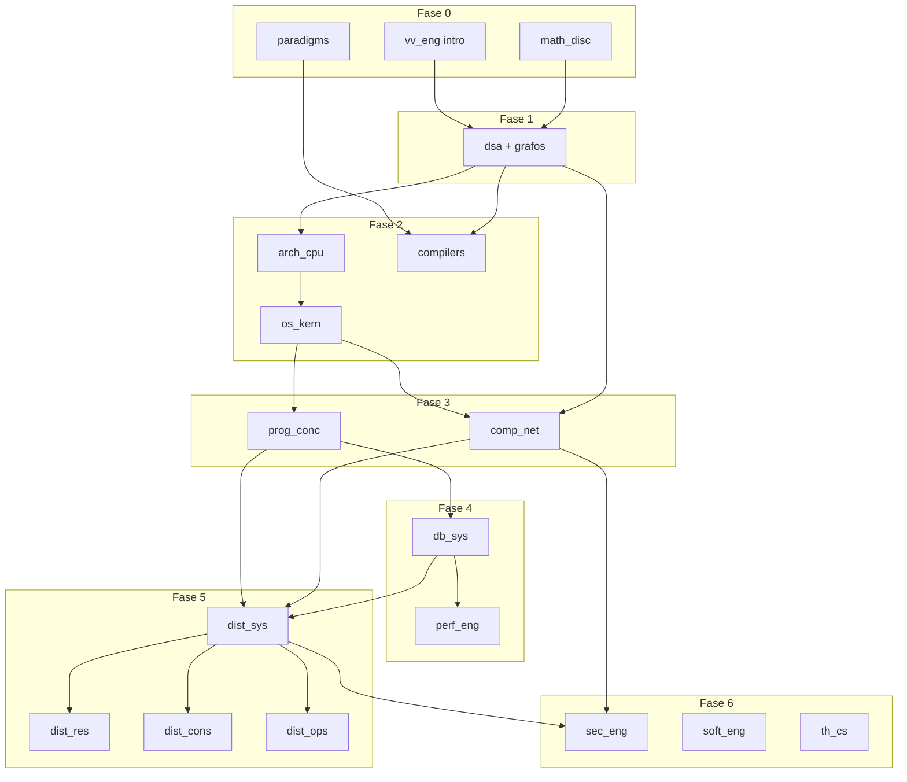

# Catálogo de livros — cs-notebooks

Cada **livro** = pasta na raiz do repositório (`prog_conc/`, `comp_net/`, …). Todos seguem o [molde pedagógico](README.md#molde-pedagógico-todos-os-livros-e-capítulos).

**Progresso e coordenação entre agentes:** [WORKBOARD.md](WORKBOARD.md) (publicados vs roteiro, reivindicações, próxima onda) · [AGENTS.md](AGENTS.md).

## Convenções

| Item | Regra |
| --- | --- |
| **Fase** | Todo livro pertence a uma fase canônica (0–6), indicada no README, catálogo e sumário. |
| **Pré-requisitos** | Cada tópico novo declara o que o estudante precisa já entender; não assume conhecimento implícito de outro tópico/livro. |
| **Pasta** | `snake_case` curto: `comp_net`, `dist_sys`, `db_sys` |
| **Capítulo** | `capitulos/NN-slug/` (`NN` = 01, 02…) |
| **localStorage** | `playground_<pasta>__<chapter-id>` (ver `practice.js` do livro) |
| **Roteiro** | `README.md` do livro + `capitulos/MAPEAMENTO.md` |
| **Sumário** | `node capitulos/_tools/build-index.mjs` |
| **Testes** | `node --test` em `model.test.js` e, se houver, `lib/*.test.js` |
| **Capítulo ouro** | Primeiro capítulo publicado define tom, HTML e lab — depois ondas |

### Criar um livro novo

```sh
node _tools/new-livro.mjs --slug db_sys --title "Bancos de dados" --brand "bancos de dados"
```

Isso copia o esqueleto de `_template-livro/`, traz `styles.css` de `prog_conc/`, e gera `README.md` inicial. Em seguida: escrever roteiro no README, preencher `MAPEAMENTO.md`, implementar cap. **01**, rodar checklist do molde.

## Ordem canônica de estudo

Visão operacional (também em [README.md § Ordem sugerida](README.md#ordem-sugerida-entre-livros-com-dependências)). **Fase** = bloco de working memory; dentro da fase, ordem numérica é recomendada.

### Tabela de dependências

| Livro | Pré-requisitos **recomendados** | Habilita / reforça | Paralelo razoável com |
| --- | --- | --- | --- |
| `vv_eng` (intro) | — | todos os labs e checklists | qualquer |
| `math_disc` | — | `dsa`, `th_cs` | `paradigms` |
| `paradigms` | — | `compilers`, `soft_eng` | `math_disc`, `dsa` |
| **`dsa`** | `math_disc` | `arch_cpu`, `compilers`, `comp_net`, `db_sys`, `dist_*`, `th_cs` | `paradigms` após estruturas básicas |
| `arch_cpu` | `dsa` | `os_kern`, `perf_eng` | `compilers` |
| `compilers` | `dsa`, `paradigms` | leitura de runtime, erros | `arch_cpu` |
| `os_kern` | `arch_cpu` | **`prog_conc`**, `comp_net`, diagnóstico | — |
| **`prog_conc`** | `os_kern` (processos/threads) | `db_sys` (isolamento), `dist_sys` | **`comp_net`** |
| **`comp_net`** | `dsa` (grafos em rotas), `os_kern` leve | `dist_sys`, `sec_eng`, `dist_ops` | **`prog_conc`** |
| `db_sys` | `prog_conc`, `dsa` | `dist_sys`, `perf_eng` | — |
| `perf_eng` | `dsa`, `arch_cpu`, `comp_net`, `db_sys` parcial | `dist_ops`, SLOs | — |
| `dist_sys` | `comp_net`, `prog_conc`, `db_sys` | `dist_res`, `dist_cons`, `dist_ops` | — |
| `dist_res` | `dist_sys` | produção resiliente | `dist_cons` após núcleo |
| `dist_cons` | `dist_sys`, `prog_conc` | consistência forte | `dist_res` |
| `dist_ops` | `dist_sys`, `comp_net`, `perf_eng` | microservices, observability | `dist_res` |
| `sec_eng` | `comp_net`, `dist_*`, `db_sys` | — | — |
| `soft_eng` | `paradigms`, `vv_eng` | — | qualquer (transversal) |
| `th_cs` | `math_disc`, `dsa` | — | `soft_eng` |

### Sequência por fases (números)

1. **Fase 0:** `vv_eng` (intro) → `math_disc` → (`paradigms` cedo ou adiado)  
2. **Fase 1:** **`dsa`** (inclui bloco completo de grafos — [escopo](#escopo-dsa-inclui-teoria-dos-grafos))  
3. **Fase 2:** `arch_cpu` → `compilers` (ordem flexível entre 2a/2b) → `os_kern`  
4. **Fase 3:** **`prog_conc`** ∥ **`comp_net`** (após base de SO; ver tabela)  
5. **Fase 4:** `db_sys` → `perf_eng`  
6. **Fase 5:** `dist_sys` → `dist_res` + `dist_cons` + `dist_ops` (ou um livro só no início)  
7. **Fase 6:** `sec_eng`, `soft_eng` (contínuo), `th_cs`

**Estado do repositório:** fases 3–4 parcialmente cobertas por **`prog_conc`** (publicado) e **`comp_net`** (em progresso). Se algo “não encaixa”, consulte a fase acima em vez de pular capítulos dentro do livro.



### Escopo `dsa` (inclui teoria dos grafos)

O livro **`dsa`** concentra **tudo de relevante em grafos para CS/SE aplicado** (não repartir em outro livro). `math_disc` traz definições (vértice, aresta, caminho, ciclo, conectividade) e provas leves; **`dsa`** traz representação e algoritmos.

| Bloco | Conteúdo previsto (caps. ou sub-roteiro) |
| --- | --- |
| Fundamentos | complexidade, vetor, lista, pilha/fila, hash, heap |
| Árvores | BST, balanceamento intro, heap como fila de prioridade |
| Ordenação / busca | comparativos, estabilidade, limite informacional básico |
| **Grafos — representação** | lista de adjacência vs matriz; peso; dirigido/não dirigido |
| **Grafos — travessia** | BFS/DFS; tempos de descoberta; componentes |
| **Grafos — estrutura** | bipartição; DAG; detecção de ciclo |
| **Grafos — caminhos** | caminho mínimo: Dijkstra, Bellman-Ford; caminho em DAG |
| **Grafos — árvores** | MST (Kruskal, Prim); árvore geradora mínima vs shortest path |
| **Grafos — ordem** | ordenação topológica; aplicações (deps, build) |
| **Grafos — avançado intro** | fluxo máximo / corte mínimo (visão operacional); matching intro opcional |
| **Grafos — conexões** | pontes com `comp_net` (rotas como caminhos), `dist_sys` (réplica como grafo), `th_cs` (NP em grafos em `th_cs`, não re-didatar em `dsa`) |

Cada tópico = experimento pequeno (prever complexidade ou resultado de BFS/Dijkstra em grafo fixo), alinhado ao molde pedagógico.

## Livros no repositório

| Fase | Slug | Título (UI) | Status |
| --- | --- | --- | --- |
| 0a | `vv_eng` | Verificação e validação | **7 capítulos** publicados |
| 0b | `math_disc` | Matemática discreta | **9 capítulos** publicados |
| 0c | `paradigms` | Paradigmas de linguagens | **8 capítulos** publicados |
| 3 | `prog_conc` | Programação concorrente | **29 capítulos** publicados |
| 3 | `comp_net` | Redes de computadores | **8 capítulos** publicados; roteiro 31 |

## Roadmap de livros (planejados)

Cada linha = um livro interativo futuro. Tópicos entre parênteses viram **caps.** ou blocos no README do livro — não precisam ser livros separados no início.

| Slug proposto | Foco do caderno | Tópicos centrais (não exaustivo) |
| --- | --- | --- |
| `db_sys` | Dados e transações | modelo relacional, álgebra/SQL mental, índices, planos, isolamento, WAL, replicação intro |
| `dist_sys` | Sistemas distribuídos | tempo e ordem, falhas, partições, réplicas, leader/follower, linearizabilidade × eventual |
| `dist_ops` | Operação distribuída | microservices (limites), observability (logs/métricas/traces), SLOs, capacity |
| `dist_res` | Resiliência na prática | timeout, retry, idempotency keys, circuit breaker, bulkhead, backpressure |
| `dist_cons` | Consistência e consenso | quorum, leader election, Raft/Paxos **enxuto**, exactly-once **mitos** |
| `dsa` | Estruturas e algoritmos | complexidade, vetores/listas, hash, árvores, ordenação; **teoria dos grafos aplicada** ([escopo](#escopo-dsa-inclui-teoria-dos-grafos)) |
| `th_cs` | Teoria da computação | autômatos, gramáticas, decidibilidade, NP, reduções — um fenômeno por capítulo |
| `arch_cpu` | Arquitetura | pipeline, cache, memória virtual, ISA vs microarquitetura, paralelismo de dados |
| `os_kern` | Sistemas operacionais | processos, threads, VM, escalonamento, FS, syscalls, segurança de SO |
| `compilers` | Compiladores | scanning, parsing, AST, análise semântica, IR, otimização leve, codegen |
| `paradigms` | Paradigmas de PL | imperativo, OO, funcional, lógico, concurrency models, tipos estáticos/dinâmicos |
| `sec_eng` | Segurança | ameaças, authn/z, cripto aplicada, TLS mental model, injection, supply chain intro |
| `soft_eng` | Engenharia de software | requisitos, acoplamento, APIs, refatoração, legado, trade-offs de design |
| `vv_eng` | Verificação e validação | pirâmide de testes, TDD leve, property-based, contratos, mutação, revisão |
| `perf_eng` | Performance | medição, profiling mental, filas, Little, caching, N+1, tail latency |
| `math_disc` | Matemática discreta | lógica, conjuntos, relações, indução; grafos **definições/provas** (algoritmos em `dsa`) |

Livros `dist_*` podem fundir-se num único `dist_sys` grosso e só depois fatiar, se preferir menos pastas.

## Áreas fundamentais (visão única)

Lista canônica alinhada ao [README.md](README.md#mapa-de-fundamentos-cs--software-engineering) da raiz — mesma taxonomia, mais detalhe por livro aqui.

| Pilar | Por que é “rocha” | Livro(s) |
| --- | --- | --- |
| Algoritmos e estruturas | Complexidade, estruturas e **grafos (algoritmos)** | `dsa` |
| Matemática discreta e lógica | Provas, indução; grafos como matemática discreta | `math_disc` |
| Teoria da computação | Limites do que é computável e classificação de problemas | `th_cs` |
| Arquitetura de computadores | Por que cache, pipeline e RAM importam para performance real | `arch_cpu` |
| Sistemas operacionais | Processos, memória, I/O — onde threads e syscalls vivem | `os_kern` |
| Redes | Ponta a ponta, latência, confiabilidade entre máquinas | `comp_net` |
| Concorrência e paralelismo | Estado compartilhado, progresso, transações locais | `prog_conc` |
| Bancos de dados | Persistência, consultas, isolamento, consistência de dados | `db_sys` |
| Sistemas distribuídos | Falha parcial, réplicas, semântica de entrega | `dist_sys`, `dist_*` |
| Segurança | Confidencialidade, integridade, superfície de ataque | `sec_eng` |
| Compiladores e linguagens | Como código vira comportamento; paradigmas e tipos | `compilers`, `paradigms` |
| Engenharia de software | Design sustentável, mudança, colaboração | `soft_eng` |
| V&V | Evidência de correção e confiança em mudanças | `vv_eng` |
| Performance | Medir antes de otimizar; filas e tail latency | `perf_eng` |

Fundamentos **transversais** (capítulos ou seções recolhidas em vários livros): ética profissional, versionamento/CI, leitura de RFC/docs, escrita clara, estimativa e risco.